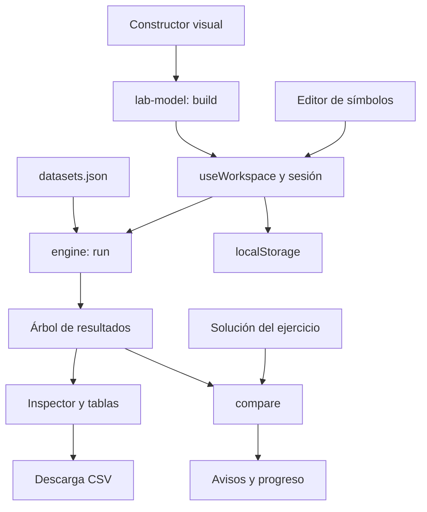

# Álgebra a la vista: documentación de funcionamiento

**Fecha:** 5 de noviembre de 2026  
**Versión declarada en `package.json`:** `3.0.0`  
**Sitio:** [Álgebra a la vista](https://algebra-a-la-vista-daniel.blondfern66.chatgpt.site)

Este documento explica la aplicación desde su uso hasta la implementación: arquitectura, datos, editor, interpretación de consultas, constructor visual, resultados, ejercicios, historial, almacenamiento, diseño responsivo y verificación. Los fragmentos indicados como pseudocódigo simplifican la implementación para facilitar su lectura.

## Índice

1. Propósito y alcance
2. Tecnologías y arquitectura
3. Organización del código
4. Datos y ejercicios
5. Arranque y navegación
6. Estado de una consulta
7. Editor de símbolos
8. Lenguaje de consultas
9. Intérprete relacional
10. Ejecución completa de una consulta
11. Implementación de los operadores
12. Constructor visual
13. Altas, bajas y modificaciones
14. Inspector y exportación CSV
15. Comprobación de ejercicios
16. Historial y persistencia
17. Interfaz responsiva y accesibilidad
18. Errores, límites y consideraciones técnicas
19. Instalación, pruebas y publicación
20. Guía de mantenimiento
21. Glosario

## 1. Propósito y alcance

Álgebra a la vista es un laboratorio educativo de álgebra relacional. Permite escribir expresiones o construirlas mediante controles visuales, ejecutar operaciones sobre tablas de ejemplo y examinar los resultados intermedios.

Las consultas trabajan sobre datos incluidos en la aplicación. Las altas, bajas y modificaciones producen nuevas relaciones como resultado; no sobrescriben las tablas originales. Una consulta posterior puede continuar transformando ese resultado porque su expresión contiene las operaciones anteriores.

La aplicación dispone de 23 ejercicios y de práctica libre. La comprobación de ejercicios compara resultados sobre los datos de ejemplo. No demuestra que dos consultas sean equivalentes para cualquier base de datos.

El procesamiento relacional y el almacenamiento del trabajo se realizan en el navegador. La aplicación no utiliza un servidor SQL para ejecutar las consultas. El alojamiento puede exigir iniciar sesión para visitar el sitio; ese acceso es independiente del motor relacional y del guardado local del progreso.

## 2. Tecnologías y arquitectura

| Tecnología | Uso en el proyecto |
| --- | --- |
| Preact | Componentes, renderizado y estado de la interfaz |
| JavaScript con módulos ES | Intérprete, modelo, sesiones y componentes |
| Vite | Servidor de desarrollo y compilación de producción |
| Tailwind CSS 4 y CSS propio | Estilos, disposición y adaptación a pantallas |
| JSON | Tablas, soluciones y resultados de referencia |
| `localStorage` | Borradores, historial, ubicación y ejercicios resueltos |
| API del navegador | Diálogos, descarga CSV, foco y consultas de tamaño de pantalla |

Las fuentes declaradas son DM Sans para el texto y Manrope para títulos, cargadas desde Google Fonts. Las expresiones utilizan una familia monoespaciada y los símbolos matemáticos tienen una familia específica.



El constructor y el editor comparten el mismo lenguaje y motor. El constructor genera texto de álgebra relacional y lo evalúa con `run()`; no mantiene un segundo motor con reglas distintas.

## 3. Organización del código

Las rutas de esta tabla son relativas a la raíz del proyecto.

| Archivo | Responsabilidad |
| --- | --- |
| `index.html` | Documento HTML, metadatos y contenedor `#app` |
| `src/main.jsx` | Importa los estilos y monta `<App/>` |
| `src/App.jsx` | Ensambla la pantalla, cambia modos y paneles, abre modales |
| `src/hooks/useWorkspace.js` | Datos activos, ejecución, comprobación y persistencia |
| `src/core/engine.js` | Tokenización, análisis y ejecución de expresiones |
| `src/core/lab-model.js` | Conversión de símbolos, generación de consultas y comparación |
| `src/core/session.js` | Estado e historial mediante un reductor |
| `src/core/query-feedback.js` | Diagnóstico con el intérprete y sugerencias para corregir errores en el editor |
| `src/components/VisualGuide.jsx` | Guía interactiva compartida entre portada y laboratorio |
| `src/data/guide.js` | Ejemplos de selección, proyección y join por base de datos |
| `src/components/Editor.jsx` | Entrada de texto y resaltado de sintaxis |
| `src/components/VisualBuilder.jsx` | Formularios de operaciones y vista previa |
| `src/components/Inspector.jsx` | Resultado seleccionado, pasos, explicaciones y CSV |
| `src/components/DataTable.jsx` | Representación de una relación como tabla |
| `src/components/Sidebar.jsx` | Bases, ejercicios, práctica libre y tablas originales |
| `src/components/ui.jsx` | Botones, iconos, campos y diálogos reutilizables |
| `src/styles.css` | Paleta, tipografías, componentes y reglas responsivas |
| `src/data/datasets.json` | Relaciones y ejercicios con expresiones de referencia |
| `src/data/tasks.js` | Enunciados que aparecen en la pantalla principal |
| `tests/fixtures/expected-results.json` | Resultados de referencia utilizados por las pruebas |
| `public/assets/` | Recursos optimizados que se copian a la compilación |
| `assets/originals/` | Imágenes fuente conservadas fuera de la compilación |
| `vite.config.js` | Integración de Preact y Tailwind, salida en `dist/` |
| `dist/` | Archivos generados para producción; no se editan a mano |

## 4. Datos y ejercicios

### Playground con archivos propios

La ruta `#playground` abre una sección independiente del laboratorio. Cada archivo CSV o JSON válido crea una tabla cuyo nombre es el del archivo sin extensión. Se pueden cargar varias tablas y consultarlas juntas con el constructor visual o el editor de símbolos. Su pantalla es un espacio de trabajo continuo: barra de importación arriba, tablas en una barra lateral estrecha a la izquierda y, a la derecha, editor amplio arriba y resultados debajo. En pantallas estrechas, estas zonas se apilan en el mismo orden.

Un CSV necesita encabezados en la primera fila y al menos una fila de datos. Admite comillas dobles, comas y saltos de línea entrecomillados. Una columna CSV se interpreta como numérica si todos sus valores son números finitos; de lo contrario se interpreta como texto. Un JSON debe ser un arreglo de objetos, por ejemplo `[{"id":1,"nombre":"Ana"}]`.

Para varias tablas en un solo archivo, se admite un TXT de grupo con sintaxis tipo QueryRelax:

```text
group: BIBLIOTECA
Libro = {
id:number, titulo:string, autor:number
1, 'Estructura de Datos', 10
}
Autor = {
autor:number, nombre:string
10, Ana
}
```

Cada relación declara sus columnas y tipos (`number` o `string`, sin distinguir mayúsculas). Las filas de texto pueden ir entre comillas simples o sin ellas; las comillas son necesarias si el valor contiene comas. Se permiten comentarios de línea iniciados con `--`. El archivo se valida completo antes de agregar sus tablas. Todas las filas deben tener las mismas columnas y cada columna debe mantener su tipo (`string` o `number`). No se aceptan celdas vacías, nombres fuera del patrón `[A-Za-z_][A-Za-z_0-9]*`, archivos de más de 2 MB ni tablas de más de 20 000 filas.

Los archivos cargados permanecen solo en la memoria de la pestaña. Al salir del playground o recargar la página, se eliminan. No usan las claves de almacenamiento del laboratorio ni modifican las bases de ejemplo.

Cada base contiene `title`, `relations` y `exercises`. Las relaciones son arreglos de objetos JavaScript. Cada objeto es una fila y cada propiedad es una columna.

Ejemplo ilustrativo de estructura:

```js
{
  title: 'Base de ejemplo',
  relations: {
    Personas: [
      { id: 1, nombre: 'Ana' },
      { id: 2, nombre: 'Luis' }
    ]
  },
  exercises: [
    {
      title: 'Nombres de personas',
      expression: 'π nombre (Personas)',
      description: 'Pista o explicación del ejercicio'
    }
  ]
}
```

### 4.1 Bases incluidas

| Base | Ejercicios | Relaciones y filas originales |
| --- | --- | --- |
| Inmobiliaria | 5 | `Vendedor`: 4; `Casa`: 7; `Ventas`: 5 |
| Ventas y clientes | 7 | `Clientes`: 4; `Productos`: 5; `Venta`: 6 |
| Biblioteca | 6 | `Libro`: 5; `Autor`: 5; `Editorial`: 4 |
| Servicios de vehículos | 5 | `Mecanicos`: 3; `Vehiculos`: 5; `Servicios`: 6; `Reparaciones`: 17 |

### 4.2 Esquemas

| Relación | Columnas |
| --- | --- |
| `Vendedor` | `numVend`, `nombre`, `apellido`, `celular` |
| `Casa` | `numCasa`, `calle`, `numero`, `colonea`, `ciudad`, `precio` |
| `Ventas` | `numVend`, `numCasa`, `fecha` |
| `Clientes` | `numCliente`, `nombre`, `apellido`, `direccion`, `telefono`, `poblacion` |
| `Productos` | `codProducto`, `descripcion`, `precio` |
| `Venta` | `idVenta`, `codProducto`, `numCliente`, `cantidad` |
| `Libro` | `numSerie`, `titulo`, `tema`, `cveAutor`, `cveEdit`, `pagunas` |
| `Autor` | `cveAutor`, `nombre`, `apellido`, `nacionalidad`, `profecion` |
| `Editorial` | `cveEdit`, `editorial`, `direccion`, `ciudad`, `pais` |

Se conserva la escritura original de campos como `colonea`, `pagunas` y `profecion`. Las consultas deben utilizar esos nombres exactos. `Venta` y `Ventas` son relaciones diferentes y pertenecen a bases distintas.

Los tipos de las tablas de ejemplo son `number` y `string`. Los teléfonos están almacenados como números y `fecha` como texto; no existe un tipo fecha específico en el intérprete.

## 5. Arranque y navegación

1. `index.html` carga `src/main.jsx`.
2. `main.jsx` monta `App` dentro de `#app`.
3. `App` llama a `useWorkspace()` para obtener datos y acciones.
4. El hook restaura la ubicación, borradores y progreso disponibles.
5. Se crea una sesión para el ejercicio activo y se evalúa su expresión restaurada o tabla inicial.
6. La pantalla muestra el constructor, el resultado y la navegación correspondiente.

La ubicación tiene esta forma:

```js
{ dataset: 0, exercise: 0 }
```

Ambos índices empiezan en cero. `exercise: null` representa práctica libre. `validLocation()` comprueba que los índices restaurados existan y utiliza valores iniciales cuando no son válidos.

La tabla inicial se elige, por orden, a partir de una fuente guardada válida, una tabla reconocida en la expresión de referencia o la primera relación de la base. Elegir otra tabla inicial reemplaza la expresión por el nombre de esa tabla.

Antes de cambiar de ejercicio, `navigate()` guarda la sesión actual, carga la siguiente y limpia los avisos y la comparación. Los borradores de distintos ejercicios permanecen separados. La pantalla vuelve al panel Consulta al cambiar de ubicación.

## 6. Estado de una consulta

`createSession()` construye el siguiente estado:

```js
{
  source,      // Nombre de la tabla inicial
  expression,  // Texto que aparece en el editor
  executed,    // Última expresión sometida a ejecución
  history,     // Expresiones confirmadas
  index,       // Posición actual dentro del historial
  assisted     // Indica que se utilizó la solución de referencia
}
```

La separación entre `expression` y `executed` permite escribir una consulta incompleta sin interpretarla como un resultado actualizado.

```js
const stale = work.expression !== work.executed;
```

Mientras `stale` sea verdadero, el hook entrega `root: null` al inspector. Así, la interfaz no presenta las filas de una ejecución anterior como si correspondieran al borrador nuevo y deshabilita la descarga al no existir un nodo seleccionado.

### 6.1 Ejecución

`execute(expression = work.expression)` intenta ejecutar el texto con `run()`:

- Si tiene éxito, confirma la expresión en la sesión y limpia avisos y comparaciones anteriores.
- Si falla, conserva el texto intentado, muestra el mensaje y no añade esa expresión al historial válido.
- Devuelve `true` o `false` para que `App` decida si cambia al panel Resultado.

Un `useMemo` evalúa `work.executed` para obtener el nodo raíz o el error que consume la interfaz. Por tanto, una ejecución puede llamar al motor una vez para validar y otra para producir el resultado derivado del estado.

## 7. Editor de símbolos

### 7.1 Dos capas superpuestas

El editor utiliza un `<textarea>` editable y un `<pre>` que muestra el texto resaltado. El texto del textarea se vuelve transparente mediante CSS, mientras su cursor permanece visible. El usuario ve los colores del `<pre>` a través de la capa editable.

Ambas capas comparten fuente, tamaño, interlineado, relleno y reglas de ajuste de línea. El evento `onScroll` copia el desplazamiento del textarea al `<pre>`. Mantener sus medidas iguales evita que el cursor y los caracteres visibles se desalineen.

### 7.2 Resaltado

`Expression()` separa el texto mediante una expresión regular y renderiza fragmentos `<span>`:

| Tipo de fragmento | Apariencia definida |
| --- | --- |
| Cadena entre comillas simples | Verde azulado |
| Símbolo de operación | Ámbar y negrita |
| Número | Azul |
| Nombre de tabla de la base activa | Verde y negrita |
| Otros fragmentos | Color de texto normal |

El resaltado facilita la lectura. La validez real se comprueba al ejecutar con el motor.

### 7.3 Conversión de palabras

`symbolize()` convierte `sigma`, `pi`, `join`, `union`, `intersect`, `cross` y `divide` en `σ`, `π`, `⋈`, `∪`, `∩`, `×` y `÷`. Solo transforma palabras completas fuera de las cadenas entre comillas, incluidas las cadenas todavía incompletas durante la edición.

Ejemplo:

```text
Entrada: sigma nombre = 'sigma join' (Vendedor join Ventas)
Salida:  σ nombre = 'sigma join' (Vendedor ⋈ Ventas)
```

Las palabras reconocidas están en minúsculas. El texto literal `'sigma join'` permanece igual.

### 7.4 Cursor e inserción

`change()` calcula la posición de selección que tendrá el texto después de convertir palabras a símbolos. Guarda esa posición en una referencia y `useLayoutEffect()` la restaura después del renderizado.

`insert(symbol)` reemplaza la selección actual por el símbolo de un botón o lo inserta donde se encuentra el cursor. Añade un espacio después de los principales operadores y devuelve el foco al editor.

El botón Ejecutar y el atajo Ctrl + Enter o Cmd + Enter llaman a `onExecute()`.

### 7.4 Revisión de expresiones y guía visual

Al dejar de escribir durante 500 ms, el editor revisa la expresión con `diagnoseExpression()`, que utiliza el mismo `run()` que la ejecución. La revisión no confirma la respuesta de un ejercicio ni añade consultas al historial. Los cambios siguen pendientes hasta pulsar **Ejecutar**. El temporizador se cancela si cambia el texto, la base o se desmonta el editor.

Una consulta válida muestra una confirmación; una inválida muestra el error del intérprete y una sugerencia de corrección. Se contemplan comillas y paréntesis sin cerrar, nombres desconocidos, proyecciones, comparadores, valores ausentes y tipos incompatibles. Los ejemplos de corrección utilizan nombres de la base activa. Cuando se conoce la posición, **Señalar en el editor** enfoca y selecciona el carácter correspondiente. El campo comunica su error mediante `aria-invalid` y enlaza el diagnóstico con `aria-describedby`. Las relaciones vacías válidas se aceptan.

La portada incluye la sección `#guia`, accesible desde **Ver la guía visual**. El botón **Guía** y la invitación **Abrir guía visual** del laboratorio abren el mismo componente dentro de un diálogo. La guía muestra datos reales: tabla original → selección de filas → proyección de columnas, con expresiones y cantidades calculadas por el intérprete. Incluye plantillas de sintaxis, instrucciones para el constructor y el editor, un diccionario y errores frecuentes.

En el laboratorio, el ejemplo corresponde a la base activa: `Casa`, `Productos` o `Libro`. **Cargar ejemplo en el editor** reemplaza el borrador de la consulta y abre el editor; el usuario pulsa **Ejecutar** para aplicarlo. Recorrer la demostración no cambia el trabajo del laboratorio. Los ejemplos viven en `src/data/guide.js`, en el mismo orden que `datasets.json`; deben actualizarse juntos si se añaden o reordenan bases. Se mantienen las claves de almacenamiento existentes.

## 8. Lenguaje de consultas

### 8.1 Formas admitidas

| Operación | Sintaxis |
| --- | --- |
| Tabla original | `Casa` |
| Selección | `σ condición (relación)` o `sigma condición (relación)` |
| Proyección | `π columna1, columna2 (relación)` o `pi ...` |
| Join natural | `relación1 ⋈ relación2` o `join` |
| Unión | `relación1 ∪ relación2` o `union` |
| Diferencia | `relación1 − relación2` o `-` |
| Intersección | `relación1 ∩ relación2` o `intersect` |
| Producto cartesiano | `relación1 × relación2` o `cross` |
| División | `relación1 ÷ relación2` o `divide` |
| Agrupación | `(expresión)` |
| Relación literal | `{ columna:tipo ... filas ... }` |

El producto cartesiano existe en el motor, aunque no aparece como operación propia en la cuadrícula del constructor. Para la división, las columnas del divisor deben estar en la primera relación y compartir tipos; el resultado conserva las columnas restantes cuyos valores se relacionan con todas las filas del divisor.

### 8.2 Valores y condiciones

- Los textos utilizan comillas simples: `'Chih'`.
- Una comilla dentro de un texto se escribe duplicada: `'O''Brien'`.
- Los números se escriben sin comillas, con punto decimal cuando corresponda.
- Se admiten números negativos.
- Los comparadores son `=`, `!=`, `>`, `<`, `>=` y `<=`.
- Las condiciones se combinan con `and` y `or`, en minúsculas.
- `and` tiene mayor prioridad que `or`; se pueden agrupar condiciones con paréntesis.
- Los nombres son sensibles a mayúsculas y minúsculas. Los identificadores admitidos comienzan con una letra ASCII o `_` y continúan con caracteres de palabra.

Ejemplo válido sobre Inmobiliaria:

```algebra
σ (precio > 1000000 or ciudad = 'Juarez') and numero > 0 (Casa)
```

### 8.3 Relaciones literales

Una relación literal declara sus columnas y tipos, seguida por sus filas:

```algebra
{ id:number, nombre:string
  1, 'Ana'
  2, 'Luis'
}
```

Los valores de una fila se separan con comas. Entre filas basta el espacio o salto de línea. Los saltos facilitan la lectura, pero no actúan como delimitadores especiales en el analizador. Los únicos tipos declarables son `number` y `string`.

### 8.4 Precedencia

| Prioridad | Operadores |
| --- | --- |
| 2: mayor | Join natural y producto cartesiano |
| 1: menor | Unión, diferencia e intersección |

Los operadores binarios de igual prioridad se agrupan de izquierda a derecha. La intersección tiene la misma prioridad que la unión en esta implementación. Conviene usar paréntesis para expresar la agrupación deseada.

## 9. Intérprete relacional

`run(text, db, schemas = {})` recibe una cadena y un objeto que relaciona nombres de tabla con arreglos de filas. El tercer argumento opcional declara los tipos de columnas de tablas vacías, por ejemplo `run('Vacia', { Vacia: [] }, { Vacia: { id: 'number' } })`. Devuelve un nodo de resultado o lanza un `Error`. Las tablas incluidas actualmente tienen filas y no necesitan este argumento.

### 9.1 Tokenización

Primero comprueba que la consulta no esté vacía y no supere 60 000 caracteres. Luego recorre el texto con una expresión regular que reconoce espacios, cadenas, números, identificadores, comparadores, símbolos y signos de agrupación.

La expresión regular utiliza las banderas `g` e `y`. `lastIndex` se sitúa en la posición que se está procesando y el modo sticky exige que el siguiente token comience allí. No se saltan caracteres desconocidos. Los espacios se descartan y el resto se guarda en `tokens`.

### 9.2 Cursor de lectura

El índice `pos` marca el token actual. Tres funciones pequeñas controlan el avance:

| Función | Comportamiento |
| --- | --- |
| `peek()` | Consulta el token actual sin consumirlo |
| `take()` | Devuelve el token actual y avanza |
| `need(token)` | Consume y exige un token concreto; si no coincide, lanza un error |

### 9.3 `atom()`: unidades de expresión

`atom()` reconoce una expresión agrupada, una selección, una proyección, una relación literal o una tabla por nombre.

Para `σ` y `π`, `unary()` acumula los argumentos anteriores al paréntesis de la relación. Usa una profundidad de paréntesis y comprueba los conectores para distinguir las condiciones agrupadas de la relación de entrada. Después llama recursivamente a `expression()` para resolver esa relación y aplica el operador.

Para una tabla, comprueba su existencia con `Object.hasOwn(db, nombre)` y obtiene sus columnas desde la primera fila o desde `schemas` si está vacía. Para un literal, lee y valida el esquema y cada valor.

### 9.4 `expression(min)`: operaciones binarias

`expression()` comienza con `atom()` y combina su resultado con operadores posteriores. Utiliza un análisis por precedencia: solo consume operadores cuya prioridad sea al menos `min` y analiza el operando derecho con `prioridad + 1`. Las funciones `combine()` y `setOperation()` ejecutan los operadores binarios.

Pseudocódigo explicativo:

```js
function expresion(prioridadMinima = 0) {
  let izquierda = atomo();
  while (siguienteOperadorTienePrioridadSuficiente()) {
    const operador = consumirOperador();
    const derecha = expresion(prioridad(operador) + 1);
    izquierda = aplicar(operador, izquierda, derecha);
  }
  return izquierda;
}
```

### 9.5 `predicate()`: condiciones

`predicate(tokens, cols, types)` produce una función que recibe una fila y devuelve verdadero o falso. Sus funciones internas reconocen valores, comparaciones y agrupaciones lógicas.

Un operando puede ser un literal o una columna existente. Si se conocen ambos tipos y son distintos, se rechaza la comparación. La igualdad utiliza `===` y la desigualdad `!==`. `and()` combina comparaciones; `or()` combina los resultados de `and()`, estableciendo así su prioridad.

### 9.6 Análisis y evaluación unidos

El motor no genera primero un árbol sintáctico independiente para ejecutarlo después. Mientras analiza una subexpresión, calcula sus filas y crea su nodo. El resultado es un árbol de operaciones ya evaluadas.

Al finalizar, comprueba que se hayan consumido todos los tokens. Si queda alguno, informa `Texto inesperado`.

## 10. Ejecución completa de una consulta

Consulta sobre Inmobiliaria:

```algebra
π nombre (σ precio > 1000000 (Vendedor ⋈ Ventas ⋈ Casa))
```

El analizador reconoce primero la proyección exterior y entra en su relación. Allí reconoce la selección y vuelve a entrar en la relación interior. Las operaciones exteriores esperan a tener el resultado de sus entradas.

El árbol se construye en este orden:

| Nodo | Operación | Filas | Columnas |
| --- | --- | --- | --- |
| 1 | Tabla `Vendedor` | 4 | 4 |
| 2 | Tabla `Ventas` | 5 | 3 |
| 3 | Join por `numVend` | 5 | 6 |
| 4 | Tabla `Casa` | 7 | 6 |
| 5 | Join por `numCasa` | 5 | 11 |
| 6 | Selección de `precio > 1000000` | 3 | 11 |
| 7 | Proyección de `nombre` | 3 | 1 |

El resultado contiene los nombres `Hugo`, `Luis` y `Jorge`. La corrección se basa en el conjunto de filas, no en que aparezcan en un orden específico.

## 11. Implementación de los operadores

### 11.1 Nodos y eliminación de duplicados

Cada operación devuelve:

```js
{
  label,     // Nombre de tabla o descripción de la operación
  cols,      // Arreglo con los nombres de columna
  types,     // Tipo de cada columna
  rows,      // Filas del resultado sin duplicados
  children   // Nodos que sirvieron como entrada
}
```

`node()` calcula los tipos desde los tipos declarados, la primera fila o, si no hay filas, sus hijos. También comprueba el límite de filas y elimina duplicados.

`key(row)` ordena las propiedades por nombre y las serializa con `JSON.stringify()`. Esa clave permite comparar filas sin depender del orden de sus propiedades. `dedupe()` usa un `Map` para conservar una fila por clave. Estas reglas implementan semántica de conjuntos.

### 11.2 Selección

Compila la condición con `predicate()` y filtra las filas:

```js
a.rows.filter(condicion)
```

Conserva las columnas originales.

```algebra
σ precio > 1000000 (Casa)
```

### 11.3 Proyección

Valida que haya columnas, que existan y que no se repitan. Construye objetos nuevos con esas propiedades y elimina las filas duplicadas que puedan resultar.

```algebra
π ciudad (Casa)
```

En los datos originales hay siete casas, pero cuatro ciudades distintas; por eso devuelve cuatro filas.

### 11.4 Join natural

Identifica todas las columnas con nombres comunes. Para cada fila izquierda, busca filas derechas cuyos valores coincidan en todas esas columnas mediante igualdad estricta y combina los objetos.

Las columnas comunes aparecen una sola vez. Las filas sin coincidencia no se incluyen. Si una columna común tiene tipos distintos en las dos relaciones, el join se rechaza con un aviso. Si no existen columnas comunes, todas las combinaciones cumplen la condición y el resultado equivale a un producto cartesiano.

```algebra
Vendedor ⋈ Ventas
```

No admite una cláusula `ON` ni alias de columnas.

### 11.5 Unión, diferencia e intersección

Exigen las mismas columnas por nombre y cantidad; el orden de las columnas puede ser diferente. También se comparan sus tipos cuando se conocen, incluso si una relación literal no tiene filas.

| Operador | Cálculo |
| --- | --- |
| Unión | Concatena las filas y elimina duplicados |
| Diferencia | Conserva las filas izquierdas cuya clave no está a la derecha |
| Intersección | Conserva las filas izquierdas cuya clave sí está a la derecha |

```algebra
Casa − (σ ciudad = 'Juarez' (Casa))
```

Esta diferencia devuelve seis casas en la base original.

### 11.6 Producto cartesiano

Genera todas las combinaciones de filas. Requiere nombres de columnas distintos entre ambas relaciones para evitar que un objeto sobrescriba propiedades del otro.

```algebra
(π numVend (Vendedor)) × (π numCasa (Casa))
```

Devuelve 28 combinaciones: cuatro vendedores por siete casas.

## 12. Constructor visual

`VisualBuilder` recibe la relación actual, las tablas disponibles, la expresión y una función `onApply`. Presenta tres momentos: elegir una operación, configurarla y revisar el resultado antes de añadir el paso. Las operaciones se agrupan por filas y columnas, comparación de relaciones y cambios de datos.

### 12.1 Configuración

`defaults()` inicializa la primera condición, la tabla sugerida para conectar y los campos de modificación. Los valores de condiciones y cambios, las columnas de proyección y la segunda relación comienzan sin completar para evitar pasos accidentales. Cuando cambia la relación, se reinician los controles para trabajar sobre sus nuevas columnas. Para un join, se sugiere una tabla todavía no usada que comparta columnas con el resultado actual; si no existe, el usuario debe elegir una.

`Conditions` permite entre una y ocho condiciones. Cada una tiene columna, comparador y valor. Se combinan con una única opción global: todas (`and`) o alguna (`or`). Las agrupaciones lógicas más complejas se escriben en el editor. El constructor señala junto al campo el primer dato incompleto o inválido y comunica arriba si el paso está incompleto, listo o produciría una relación vacía.

### 12.2 Generación y vista previa

Un `useMemo` calcula:

```js
const next = build(expression, config, tables);
const result = run(next, tables);
```

`build()` evalúa la expresión actual para conocer su esquema, valida los campos, construye una expresión nueva, comprueba que pueda ejecutarse y devuelve el texto con símbolos normalizados.

La vista previa muestra el cambio de número de filas, las columnas resultantes y hasta tres filas de ejemplo. Si faltan campos o la operación no está definida para esos esquemas o tipos, indica el motivo mientras se edita y desactiva «Añadir paso». El selector de relaciones compatibles para unión, diferencia e intersección comprueba nombres y tipos de columnas. Todavía no confirma la operación en el historial. Al pulsar «Añadir paso», se llama a `onApply()` y se calcula la expresión generada para continuar construyendo, pero el panel Resultado permanece pendiente. Las filas del panel aparecen al pulsar «Ejecutar y ver resultado», «Ejecutar» en el editor o «Comprobar» en un ejercicio. En un ejercicio, «Comprobar» valida por separado si la consulta completa resuelve el reto. En práctica libre, el constructor invita a seguir encadenando operaciones o explorar el resultado, sin mostrar instrucciones de comprobación.

### 12.3 Funciones del modelo

| Función de `lab-model.js` | Papel |
| --- | --- |
| `symbolize(text)` | Normaliza palabras de operadores fuera de cadenas |
| `value(raw, type)` | Convierte valores; rechaza campos sin completar y números vacíos o no finitos |
| `quote(value)` | Serializa valores y escapa comillas de texto |
| `condition(filters, logic, relation)` | Genera condiciones sobre columnas válidas |
| `literal(rows, relation)` | Genera una relación literal con esquema |
| `build(source, config, db)` | Traduce una operación visual a una expresión válida |
| `compare(actual, expected)` | Compara columnas y conjuntos de filas |
| `suggestJoinTable(relation, tables)` | Sugiere una tabla no usada con columnas comunes |
| `builderIssue(config, relation)` | Localiza el primer campo incompleto o inválido para mostrarlo durante la edición |

Al volver del editor al constructor, si hay cambios sin ejecutar, `App` intenta ejecutarlos primero. Si fallan, permanece en el editor.

## 13. Altas, bajas y modificaciones

Estas acciones se expresan con operadores de conjuntos. En las fórmulas siguientes, `R` es la expresión actual, `C` la condición, `N` las filas nuevas y `M` las filas modificadas. Son nombres explicativos, no variables declaradas en el lenguaje.

| Acción visual | Expresión conceptual |
| --- | --- |
| Alta | `R ∪ N` |
| Baja | `R − σ C (R)` |
| Modificación | `(R − σ C (R)) ∪ M` |

### 13.1 Alta

El constructor solicita un valor por columna, convierte cada tipo y crea una relación literal. Después une esa relación a la expresión actual.

Ejemplo ejecutable sobre Inmobiliaria:

```algebra
Vendedor ∪ { numVend:number, nombre:string, apellido:string, celular:number
  6000, 'Carlos', 'Mendoza', 6140000000
}
```

El resultado tiene cinco vendedores. Si se añade una fila idéntica a otra existente, la semántica de conjuntos elimina el duplicado. No se valida una restricción de clave primaria: dos filas con igual identificador y otros valores distintos pueden coexistir.

### 13.2 Baja

La condición selecciona las filas que se retirarán. La diferencia las elimina del resultado, manteniendo el esquema y las demás filas.

### 13.3 Modificación

`build()` evalúa la selección, copia cada fila coincidente y cambia una propiedad. Admite sustituir un valor o sumar una cantidad a una columna numérica. Luego serializa esas filas como un literal y genera diferencia más unión.

El aumento de precios se calcula en JavaScript al construir el literal. El motor no interpreta una asignación general como `precio = precio + 500000`. El símbolo `↦` identifica la acción visual, pero no es un operador de modificación ejecutable en `engine.js`.

Las filas modificadas quedan materializadas en la expresión generada. Las tablas originales permanecen disponibles sin alteraciones.

## 14. Inspector y exportación CSV

`Inspector` recibe el nodo raíz, el estado de cambios pendientes, los errores y, cuando procede, el resultado esperado.

### 14.1 Recorrido de operaciones

El inspector recorre primero los hijos de cada nodo y después añade el nodo actual. Este recorrido en postorden produce una lista donde las entradas aparecen antes que la operación que las consume.

Guarda un mapa entre nodos e índices para indicar qué pasos alimentan a cada operación. Cuando cambia el árbol, selecciona su último nodo: el resultado final. Los botones anterior y siguiente o la lista permiten inspeccionar otros nodos sin volver a ejecutar la consulta.

`explain()` genera una explicación usando etiquetas y cantidades: filas conservadas por un filtro, columnas de una proyección, coincidencias de un join o filas retiradas por una diferencia.

### 14.2 Tabla de datos

`DataTable` recibe la relación y representa `cols` en el encabezado y `rows` en el cuerpo. Tiene encabezado fijo, desplazamiento dentro de la región y un mensaje explícito para relaciones vacías. El modo compacto limita su altura en modales y comparaciones.

### 14.3 CSV

La descarga utiliza el nodo seleccionado, que puede ser un paso intermedio. Incluye nombres de columna y valores, todos entre comillas dobles, duplicando cualquier comilla interna. Usa separadores por coma, finales de línea CRLF y una marca BOM UTF-8.

Se crea un `Blob`, una URL temporal y un enlace de descarga llamado `resultado-paso-N.csv`. La URL se libera después de iniciar la descarga. Si no existe nodo, el botón está deshabilitado.

## 15. Comprobación de ejercicios

`check()` requiere un ejercicio activo y una consulta que pueda ejecutarse. Evalúa la consulta del usuario y la expresión de referencia sobre las mismas relaciones originales.

`compare()` calcula:

```js
{
  correct,
  missingColumns,
  extraColumns,
  missing,
  extra
}
```

Para que `correct` sea verdadero, no debe faltar ni sobrar ninguna columna o fila. Las filas se comparan mediante `key()`, sin depender del orden de presentación.

Tras una comprobación correcta, el panel Resultado muestra una explicación propia del ejercicio: qué demuestra la relación obtenida y qué operaciones del álgebra relacional justifican esa respuesta. Complementa el recorrido, que describe los cambios de cada paso de la consulta. Las explicaciones están en `src/data/explanations.js`, alineadas con los índices de ejercicios de `datasets.json`. Se ocultan al editar, ejecutar otra consulta, cambiar de ejercicio o reiniciar; completar un reto sigue requiriendo «Comprobar».

Si las columnas difieren, el aviso muestra cuáles faltan o sobran. Si coinciden las columnas pero difieren las filas, informa sus cantidades. También se ofrece una tabla con el resultado esperado.

### 15.1 Pista, solución y progreso

- **Pista:** muestra `description` del ejercicio.
- **Solución:** carga la expresión de referencia, marca la sesión como asistida y abre el editor.
- **Comprobar:** si el resultado coincide, añade el ejercicio a resueltos la primera vez, incluso si se consultó la solución.
- **Reiniciar:** vuelve a la tabla inicial y elimina la marca de asistencia.

Ver la solución no marca automáticamente el ejercicio como resuelto: hay que pulsar «Comprobar». Reiniciar la consulta no borra un ejercicio ya registrado como completado.

Los identificadores de progreso combinan índices de base y ejercicio, por ejemplo `0:2`. El máximo global se calcula a partir de los ejercicios de todas las bases. La base de servicios se añadió al final para conservar las claves anteriores.

## 16. Historial y persistencia

### 16.1 Reductor de sesión

| Acción | Efecto |
| --- | --- |
| `load` | Sustituye el estado por una sesión cargada |
| `edit` | Cambia el borrador sin confirmar una ejecución |
| `execute` válida | Confirma la expresión mediante `commit()` |
| `execute` inválida | Guarda el intento como texto ejecutado sin añadirlo al historial |
| `solution` | Confirma la solución y marca asistencia |
| `source` | Cambia tabla inicial, confirma su nombre y elimina asistencia |
| `reset` | Confirma la tabla inicial y elimina asistencia |
| `undo` | Restaura el punto válido actual o retrocede en el historial |
| `redo` | Avanza si no hay un borrador diferente del punto actual |

`commit()` conserva como máximo 50 entradas. Una ejecución nueva después de deshacer descarta la rama futura. Confirmar una expresión idéntica a la entrada actual no crea un duplicado consecutivo.

Si hay un borrador distinto del historial, el primer Deshacer restaura la entrada válida actual; el siguiente retrocede. Una consulta inválida no contamina el historial de operaciones válidas.

### 16.2 Claves de almacenamiento

| Clave de `localStorage` | Contenido |
| --- | --- |
| `lab-drafts-v2` | Sesiones por base y ejercicio o práctica libre |
| `lab-location-v3` | Ubicación activa |
| `lab-progress` | Identificadores de ejercicios resueltos |

Cada borrador guarda `source`, `expression`, `history`, `historyIndex` y `assisted`. La clave de práctica libre utiliza `free`, por ejemplo `0:free`.

`executed` no se persiste por separado. Al restaurar, `createSession()` toma la expresión guardada como expresión ejecutada y el hook vuelve a evaluarla. Un borrador incompleto restaurado puede mostrar un error hasta corregirlo.

El guardado se intenta al cambiar la sesión o la ubicación y antes de navegar. Las lecturas y escrituras se protegen con `try/catch`. Si una escritura falla, el trabajo permanece en memoria durante esa sesión y la interfaz avisa que no se pudo guardar.

El almacenamiento pertenece al navegador, perfil y origen del sitio. No sincroniza el progreso entre dispositivos. Borrar los datos del navegador elimina esos borradores y ese progreso. La vista previa local y el sitio publicado tienen orígenes diferentes y, por tanto, almacenamientos separados.

## 17. Interfaz responsiva y accesibilidad

### 17.1 Distribución por tamaño

| Ancho del viewport | Navegación | Espacio de trabajo |
| --- | --- | --- |
| Menos de 1024 px | Menú lateral desplegable | Un panel visible con selector Consulta/Resultado |
| De 1024 a menos de 1280 px | Barra lateral permanente | Un panel visible con selector |
| Desde 1280 px | Barra lateral permanente | Consulta y Resultado en dos columnas |

Por debajo de 1280 px, el selector permanece visible durante el desplazamiento. Al aplicar una operación o ejecutar correctamente el editor, `showPanel()` cambia al resultado, desplaza su encabezado a la vista y sitúa allí el foco. Una ejecución fallida mantiene el editor visible.

Las condiciones utilizan una consulta de contenedor: si el panel mide como máximo 420 px, sus controles se reparten en dos filas. La decisión depende del ancho del panel, no solo del ancho de la ventana. Las tablas conservan su propio desplazamiento horizontal.

### 17.2 Teclado y estructura

- Existe un enlace para saltar al laboratorio.
- Los campos y botones tienen etiquetas visibles o `aria-label`.
- Los modos y el selector de panel comunican su estado mediante `aria-pressed`.
- El menú móvil contiene el foco con Tab y Shift + Tab y se cierra con Escape.
- Mientras el menú está abierto, encabezado y área principal quedan `inert`.
- Al cerrar el menú, el foco vuelve al botón de apertura si sigue visible.
- Cambiar a un ancho de escritorio cierra el menú móvil.
- Los modales utilizan `<dialog>` y `showModal()`.
- Los avisos y resultados utilizan regiones de estado o `aria-live`.
- La hoja de estilos define foco visible y respeta la preferencia de movimiento reducido.

Los controles principales se ampliaron para el uso táctil y el editor mantiene iguales sus dos capas también en móvil. Estas medidas describen la implementación; no equivalen a una certificación de accesibilidad.

## 18. Errores, límites y consideraciones técnicas

### 18.1 Errores representativos

| Situación | Respuesta del motor o del modelo |
| --- | --- |
| Consulta vacía | Solicita escribir una expresión o elegir una tabla |
| Carácter no reconocido | Indica la posición del símbolo |
| Tabla inexistente | `Relación desconocida` |
| Columna inexistente en condición | `Columna desconocida` |
| Condición sin valor | Explica que falta el valor y da un ejemplo |
| Comparador no válido | Enumera los comparadores admitidos |
| Número comparado con texto | Informa tipos distintos |
| Proyección sin columnas válidas | Solicita revisar las columnas |
| Columna repetida en proyección | Informa la repetición |
| Operaciones de conjuntos incompatibles | Informa columnas o tipos incompatibles |
| Join con tipos distintos en una columna común | Indica la columna incompatible y solicita usar tipos iguales |
| Producto con columnas homónimas | Exige nombres distintos |
| Tokens sobrantes | `Texto inesperado` |

### 18.2 Límites efectivos

| Elemento | Límite |
| --- | --- |
| Longitud de consulta | 60 000 caracteres |
| Filas generadas por operación | 20 000 antes de eliminar duplicados |
| Historial por sesión | 50 expresiones |
| Condiciones del constructor | Entre 1 y 8 |

El motor es síncrono. El join y el producto se detienen al intentar generar la fila 20 001; las demás operaciones comprueban el límite al crear el nodo. Esto evita materializar combinaciones demasiado grandes, pero no impide un cálculo costoso cuando hay muchas parejas sin coincidencia o consultas muy anidadas.

### 18.3 Alcance del lenguaje y del modelo

- No utiliza `eval()` ni ejecuta el texto como JavaScript.
- No ofrece SQL, agregaciones, ordenamiento, alias, renombrado, joins externos ni funciones generales de cadenas o fechas.
- No implementa `NULL` ni lógica ternaria de SQL.
- No hay un optimizador: se respeta la estructura escrita y la precedencia del analizador.
- No interpreta asignaciones o aritmética general en proyecciones o condiciones; las sumas del constructor se materializan antes como literales.
- Las tablas originales obtienen su esquema de la primera fila. Una tabla vacía necesita tipos declarados en el argumento `schemas` de `run()`; los datos actuales no incluyen tablas vacías.
- Un literal vacío no conserva todos sus tipos como metadatos en `node()`, porque no tiene filas ni hijos de los que inferirlos. La inferencia de tipos no sustituye a un esquema relacional completo.
- No aplica claves primarias, claves foráneas ni restricciones de unicidad por identificador.
- Las filas se tratan como conjuntos; no debe dependerse de su orden para resolver un ejercicio.
- Las columnas comunes del join se descubren por nombre; una coincidencia accidental de nombres cambia la condición del join.
- El resaltado del editor reconoce más símbolos decorativos que el motor: colorear un carácter no garantiza que sea ejecutable.

## 19. Instalación, pruebas y publicación

### 19.1 Desarrollo local

Desde la raíz del proyecto, con Node.js y npm compatibles con las dependencias y el archivo de bloqueo:

```sh
npm ci
npm run dev
```

Vite muestra la dirección de la vista previa. El script `dev` está configurado para escuchar en `0.0.0.0`.

### 19.2 Comandos

| Comando | Función |
| --- | --- |
| `npm ci` | Instala las dependencias según el archivo de bloqueo |
| `npm run dev` | Inicia el servidor de desarrollo |
| `npm test` | Ejecuta las pruebas del motor, regresiones, constructor y sesión |
| `npm run build` | Genera la salida de producción en `dist/` |
| `npm run preview` | Sirve la compilación para revisión local |

No hay un comando de lint ni de comprobación de TypeScript declarado en `package.json`.

### 19.3 Qué verifican las pruebas

| Archivo | Cobertura |
| --- | --- |
| `tests/test-engine.cjs` | Los 23 resultados completos contra `tests/fixtures/expected-results.json` y 9 comprobaciones adicionales de operadores y errores |
| `tests/test-regressions.cjs` | 6 casos: consulta vacía, agrupación lógica, negativos, condición incompleta, columna proyectada duplicada y tipos incompatibles |
| `tests/test-builder.cjs` | Generación de operaciones, conversión de símbolos, sugerencias de join y comparación |
| `tests/test-session.mjs` | 5 pruebas de edición, deshacer/rehacer, ejecución inválida, restauración y límite del historial |
| `tests/test-operations.mjs` | Operaciones relacionales, modificaciones, cadenas y tipos de relaciones vacías |
| `tests/test-guide.mjs` | Resultados independientes de las cuatro demostraciones y conservación de los datos originales |
| `tests/test-query-feedback.mjs` | Diagnósticos y correcciones, consultas válidas vacías, comillas escapadas y sugerencias según la base |
| `tests/test-completion.mjs` | Progreso al completar ejercicios y explicaciones asociadas |

Las pruebas de datos y sesión no verifican por sí solas la distribución visual. Durante la revisión de la interfaz se comprobó en navegador el comportamiento a 320, 768, 1024 y 1440 px, la ejecución válida e inválida, el menú con Escape, la guía y el cambio de panel. No se realizó una certificación formal de accesibilidad.

### 19.4 Compilación y alojamiento

Vite integra los plugins de Preact y Tailwind. Su compilación vacía y vuelve a generar `dist/`, con `index.html` y archivos estáticos de JavaScript y CSS.

Para publicar el proyecto en un alojamiento estático, se ejecuta `npm run build` y se configura `dist/` como directorio de salida. Si el sitio se publica bajo una subruta, se debe ajustar la base de Vite y comprobar las rutas absolutas de los recursos.

No se deben editar los archivos generados de `dist/` para cambiar el producto: el siguiente build los reemplazaría. Los cambios se realizan en `src/` y se recompilan.

## 20. Guía de mantenimiento

### 20.1 Añadir un ejercicio

1. Añadir título, expresión de referencia y descripción en `datasets.json`.
2. Añadir el enunciado correspondiente en `tasks.js`, manteniendo el mismo índice.
3. Incorporar el resultado esperado independiente en `tests/fixtures/expected-results.json`.
4. Ejecutar las pruebas y revisar el ejercicio en ambos modos.
5. Comprobar el máximo global de progreso y actualizar la documentación afectada.

El orden de bases y ejercicios forma parte de sus claves de persistencia. Reordenarlos puede asociar borradores o progreso con otro ejercicio y requiere una estrategia de migración.

### 20.2 Cambiar o añadir tablas

Mantener nombres exactos y tipos homogéneos. Si se añade una tabla vacía, declarar su esquema y pasarlo a `run()` desde los puntos de uso de la aplicación. Revisar las columnas comunes que utilizarán los joins y actualizar soluciones, enunciados y resultados de referencia. Añadir un nombre de tabla nuevo puede requerir ajustar el reconocimiento de tabla inicial en `load()`.

### 20.3 Añadir un operador

Revisar conjuntamente la tokenización, `atom()` o `expression()`, la precedencia si es binario, el nodo y sus tipos, la conversión y resaltado del editor, el constructor si corresponde, las explicaciones del inspector y las pruebas. Un botón nuevo sin soporte del motor no basta para ampliar el lenguaje.

### 20.4 Modificar estilos

Preservar las métricas compartidas del textarea y el `<pre>`. Revisar tanto el ancho del viewport como el ancho real de los paneles. Probar tablas anchas, títulos largos, condiciones múltiples, teclado y cambio de orientación o tamaño con el menú abierto.

### 20.5 Localizar problemas

| Síntoma | Primer punto que revisar |
| --- | --- |
| El texto se ve desalineado con el cursor | Métricas y desplazamiento de las dos capas del editor |
| Un símbolo se colorea pero falla al ejecutar | Tokens y operaciones de `engine.js` |
| El constructor genera una consulta incorrecta | `build()` y serialización de valores/literales |
| Aparecen columnas inesperadas tras un join | Nombres comunes de ambas relaciones |
| Un resultado anterior desaparece al editar | Estado `stale`; es el comportamiento previsto |
| No se recupera el progreso en otro dispositivo | Guardado local por navegador y origen |
| Una respuesta coincide pero no suma progreso | El ejercicio ya está registrado en `lab-progress` o el almacenamiento local no está disponible |
| El CSV corresponde a una tabla intermedia | Nodo seleccionado en el inspector |
| Una consulta válida falla al ampliar datos | Límite de filas, combinaciones del join y tipos/esquema |

## 21. Glosario

| Término | Significado en esta aplicación |
| --- | --- |
| Relación | Tabla representada por columnas y un conjunto de filas |
| Tupla | Una fila de una relación |
| Esquema | Nombres de columnas y sus tipos |
| Token | Pieza reconocida del texto de consulta |
| Analizador | Código que reconoce la estructura del lenguaje |
| Predicado | Función que decide si una fila cumple una condición |
| Nodo | Resultado de una tabla u operación con referencias a sus entradas |
| Raíz | Nodo que contiene el resultado final |
| Postorden | Recorrido que visita entradas antes de su operación |
| Borrador | Texto que se está editando |
| `stale` | El borrador difiere de la expresión ejecutada |
| Sesión | Consulta, fuente, historial y asistencia de un ejercicio |
| Semántica de conjuntos | Filas duplicadas eliminadas y comparación sin depender del orden |
| Relación literal | Tabla escrita directamente con esquema y valores |
